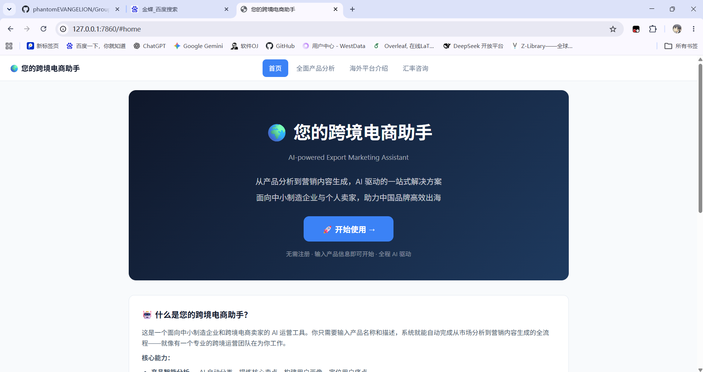
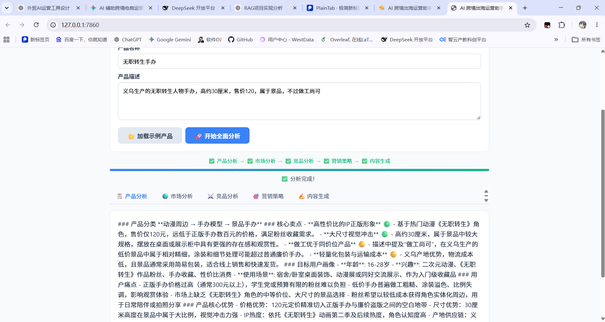
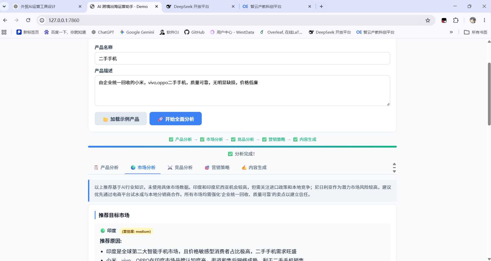
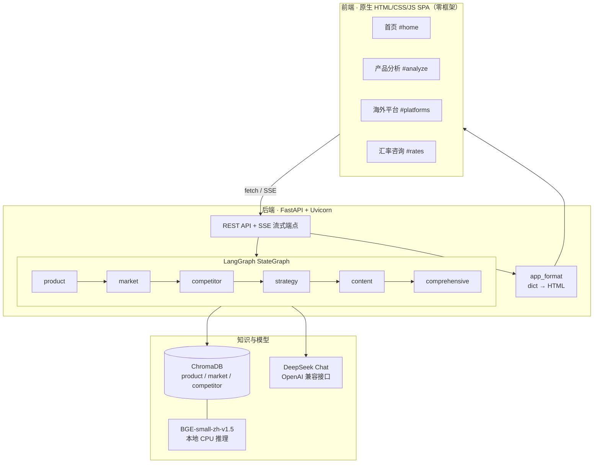

# AI 跨境电商运营助手

> **AI-Powered Cross-Border E-commerce Operations Assistant**
> 输入一个产品，一分钟内产出一套可直接执行的出海运营方案。

<p>


</p>

---

## 项目背景

中小制造企业和个人卖家出海时，普遍卡在同一件事上：**从「我有这个产品」到「我知道怎么卖到海外」，中间隔着产品定位、目标市场、竞品格局、渠道策略、本地化文案、物流成本六道坎**，每一道都需要不同的专业知识，小团队往往一个人身兼六职，靠拍脑袋决策。

这个项目把这条链路做成了一个 **多节点 AI 工作流**：用户只需输入产品名称、描述或上传产品资料，系统在 30–60 秒内依次完成六个环节的分析，并通过 SSE 实时把结果推到前端——不是一次性吐一大段文字，而是每一步完成就能看。

---

## 核心能力

| 模块 | 能力 |
|------|------|
| **全面产品分析** | 6 节点流水线：产品分析 → 市场洞察 → 竞品对比 → 营销策略 → 文案编写 → 综合报告（含物流运输方案） |
| **海外平台指南** | Amazon、eBay、TikTok、YouTube、X、Walmart 六大平台的入驻要点与运营建议 |
| **汇率咨询** | 13 种货币实时汇率（30 分钟缓存）+ 近 12 个月走势图 + 线性回归 7 日预测 |
| **多格式输入** | 支持直接输入产品信息，或上传 PDF / DOCX / TXT / MD / JSON 产品资料 |

### 六节点流水线做了什么

```
📄 产品资料（文本 / PDF / DOCX / MD / JSON）
        ↓
📚 RAG 检索（ChromaDB + BGE Embedding，按品类召回市场与竞品数据）
        ↓
🤖 LangGraph 工作流（6 节点 DAG，逐节点流式输出）
   ├─ 01 产品分析   品类判定 · 核心卖点 · 用户画像 · 痛点拆解
   ├─ 02 市场分析   目标国家推荐 · 市场规模 · 头部企业 · 准入认证 · 行业展会
   ├─ 03 竞品分析   竞品对比表 · 差异化机会 · 产品改进建议（含影响/投入评级）
   ├─ 04 营销策略   品牌定位 · 渠道组合 · 内容方向
   ├─ 05 文案编写   Amazon Listing · TikTok 脚本 · 开发信 · 直播话术（中英双语）
   └─ 06 综合报告   核心摘要 · 海运/空运对比与运费参考 · 下一步行动清单
```

---

## 界面预览

<table>
  <tr>
    <td width="50%"></td>
    <td width="50%"></td>
  </tr>
  <tr>
    <td align="center"><sub>首页 · 产品定位与入口</sub></td>
    <td align="center"><sub>产品分析 · 品类判定与用户画像</sub></td>
  </tr>
</table>



<p align="center"><sub>市场分析 · 目标国家推荐、置信度标注与数据来源说明</sub></p>

---

## 技术架构



### 技术栈

| 层次 | 选型 | 用途 |
|------|------|------|
| Web 框架 | FastAPI + Uvicorn | REST API、SSE 流式响应、文件上传 |
| 工作流编排 | LangChain ≥0.2 + LangGraph | StateGraph 六节点 DAG，状态在节点间流转 |
| 向量检索 | ChromaDB（本地持久化） | 3 个 Collection：产品 / 市场 / 竞品 |
| Embedding | BAAI/bge-small-zh-v1.5 | 本地 CPU 推理，加载失败自动降级 OpenAI 兼容接口 |
| 大模型 | DeepSeek `deepseek-chat` | 分析与生成分离控温：0.3 / 0.5 |
| 前端 | 原生 HTML/CSS/JS | Hash 路由 4 页面，无框架依赖，Canvas 手绘折线图 |
| 文档解析 | PyMuPDF、python-docx | PDF / DOCX / TXT / MD / JSON |

---

## 工程亮点

> 这一节是这个项目真正的技术含量所在——每个问题都是开发过程中真实撞上的，不是事后编的。

### 1. RAG 检索的相关性降级机制

**问题**：知识库预置了 9 个品类的市场与竞品数据。当用户输入一个知识库没覆盖的品类（比如「户外储能电源」），向量检索依然会返回「最相似」的文档——但那是智能手表的数据。把这些脏数据塞进 Prompt，模型会一本正经地拿手表市场的数据去分析储能电源，输出看起来专业、实际上完全错误的结论。

**方案**：改用 `similarity_search_with_relevance_scores()` 拿到每条结果的相关性分数，与阈值（`RAG_SCORE_THRESHOLD = 0.45`）比较。低于阈值即判定「品类不匹配」，跳过 RAG 数据，Prompt 切换为「基于你自身的行业知识完成分析」，并在前端数据来源区以灰色斜体标注降级状态。

**效果**：未覆盖品类不再输出张冠李戴的数据；同时用户能清楚知道哪些结论来自知识库、哪些来自模型推理，可信度边界是可见的。

### 2. LLM 结构化输出的四层容错解析

**问题**：工作流每一步都要求模型返回严格 JSON，但实际调用中模型会加解释性前缀、包 ```json 代码块、漏逗号、用中文引号。一次解析失败就意味着整条链路断掉。

**方案**：`_safe_parse_json()` 四级递进降级——

1. 直接 `json.loads()`
2. 正则提取 ```json ... ``` 代码块后再解析
3. 正则提取最外层 `{ ... }` 后再解析
4. `json_repair` 自动修复残缺 JSON

四级全失败则保留原始文本降级展示，不让整条工作流崩掉。

**效果**：结构化输出从「偶发解析失败」变为稳定可用，且失败时前端仍能看到内容而不是空白页。

### 3. SSE 流式输出替代同步等待

**问题**：六节点串行调用 LLM，同步接口下用户要盯着 loading 等 60 秒以上才能看到第一个字，中途失败更是全部白等。

**方案**：新增 `/analyze-stream` 端点，返回 `StreamingResponse`（`text/event-stream`）。每完成一个节点立刻 `yield` 一条 SSE 事件（含步骤号、格式化后的 HTML、当前错误列表）；节点函数通过 `run_in_executor` 放到线程池执行，避免阻塞事件循环。前端用 `fetch` + `ReadableStream` 逐块解析，边收边渲染对应 Tab 并弹出 Toast。

**效果**：首屏不必等整条链路跑完，第一个节点的结果一出来就能看；进度条真实反映执行进度；单节点异常被写入 `state["errors"]` 而不中断后续节点，用户最终拿到的是「部分成功」而不是「整体失败」。

### 4. 一次架构级重构：从 Gradio 迁到 FastAPI + 原生 SPA

**问题**：初版用 Gradio 快速搭了原型，但很快撞墙——Gradio 的 generator 机制在多步骤状态传递下不稳定，长耗时分析过程中频繁白屏无响应，组件化 UI 也撑不住「多级 Tab + 复杂表格」的展示需求。

**方案**：彻底弃用 Gradio，改为 FastAPI 提供 API、前端用原生 HTML/CSS/JS 写 SPA（Hash 路由 4 页面），流式改用 SSE，格式化逻辑抽成独立模块 `app_format.py`。

**效果**：白屏问题消失，UI 完全可控（置信度标签、数据卡片、代码块、Canvas 折线图都是手写的），并顺手拿到了多页面能力和更清晰的 API 边界。

### 5. 双 Embedding 兜底与知识库幂等初始化

本地 BGE 模型加载失败时自动降级到 OpenAI 兼容 Embedding，避免因一次模型下载失败导致整个应用起不来；启动时按 Collection 计数判断是否已初始化，避免每次重启重复灌库。

### 6. 零依赖的前端图表

汇率走势图没有引入 ECharts 或 Chart.js，而是用 Canvas 手绘：面积填充、网格线、月度刻度、最高/最低/变动幅度统计，再把线性回归算出的 7 日预测用虚线画在右侧。整个前端不依赖任何 CDN 资源，断网也能正常渲染。

---

## 快速开始

### 环境要求

- Python 3.10+
- DeepSeek API Key（[获取地址](https://platform.deepseek.com/)）
- 首次运行需联网下载 BGE Embedding 模型（约 33 MB），之后可离线使用

### 启动

```bash
git clone https://github.com/phantomEVANGELION/GroupProject.git
cd GroupProject/ai-export-demo

pip install -r requirements.txt

# 配置密钥（.env 已被 .gitignore 排除，不会进仓库）
echo "DEEPSEEK_API_KEY=sk-your-key-here" > .env

python app.py
# 打开 http://127.0.0.1:7860
```

首次启动会自动完成：下载 Embedding 模型 → 初始化市场/竞品知识库到 ChromaDB → 启动服务。

### 试用路径

1. 首页点「开始使用」→ 进入产品分析页
2. 点「加载示例产品」自动填充 `X100 智能运动手表`（也可自行输入或上传 PDF/DOCX/TXT/MD/JSON）
3. 点「开始全面分析」，观察进度条逐步推进，六个 Tab 依次点亮
4. 到「汇率咨询」点击任一货币卡片，查看 12 个月走势与 7 日预测

---

## 项目结构

```
GroupProject/
├── README.md                     # 本文件
├── HANDOVER.md                   # 交接文档（架构要点、API 说明、踩坑记录）
├── docs/                         # 开发日志、项目档案
└── ai-export-demo/
    ├── app.py                    # FastAPI 入口 + 内嵌 SPA 前端（4 页面，6 个路由）
    ├── app_format.py             # 结果格式化层：dict → 原生 HTML
    ├── config.py                 # 配置中心：模型、阈值、路径
    ├── requirements.txt
    │
    ├── workflow/                 # LangGraph 工作流
    │   ├── graph.py              #   六节点 DAG 定义
    │   ├── state.py              #   WorkflowState TypedDict
    │   └── nodes.py              #   节点实现 + 四层 JSON 容错
    │
    ├── rag/                      # 检索基础设施
    │   ├── chroma_client.py      #   ChromaDB 管理 + 双 Embedding 兜底
    │   ├── loader.py             #   多格式文档加载与切分
    │   └── prompts.py            #   六套 Prompt 模板
    │
    ├── knowledge_base/           # 预置知识库
    │   ├── market/               #   12 份市场数据（9 品类 + 物流专题）
    │   └── competitors/          #   9 份竞品数据（每品类 5 个竞品）
    │
    ├── init_knowledge_base.py    # 知识库幂等初始化
    ├── sample_data/              # 示例产品数据
    └── data/                     # ChromaDB 持久化 / 上传临时文件（gitignore）
```

**规模**：约 3,300 行 Python（不含内嵌前端），6 个 API 路由，9 大品类知识库。

---

## API 一览

| 方法 | 路径 | 说明 |
|------|------|------|
| GET | `/` | SPA 前端 |
| POST | `/upload` | 上传产品资料（PDF/DOCX/TXT/MD/JSON） |
| POST | `/analyze-stream` | **SSE 流式分析**，每节点完成即推送 |
| POST | `/analyze` | 同步分析（向后兼容） |
| GET | `/api/rates` | 13 种货币实时汇率（30 分钟缓存） |
| GET | `/api/rates/history` | 近 12 个月汇率 + 7 日线性回归预测 |

---

## 设计取舍与已知限制

这个项目定位是**可运行的完整原型**，不是生产系统。边界说清楚比藏着更有价值：

| 限制 | 说明 |
|------|------|
| 市场/竞品数据 | 来自预置的 9 大品类知识库，非实时行情；未覆盖品类走 LLM 推理并显式标注 |
| 无用户体系 | 单用户单进程，未做鉴权与并发隔离 |
| 无历史记录 | 每次分析结果不落库，刷新即丢失 |
| 图片输入 | 暂不支持 OCR，上传图片会返回明确提示 |
| 移动端 | 仅基础响应式，未做完整适配 |

**Roadmap**

- [ ] 接入 Amazon SP-API / Google Trends，替换预置数据
- [ ] 图片 OCR（PaddleOCR / Tesseract）支持产品图与包装识别
- [ ] 多轮追问：在六节点结果上做增量迭代，而非每次重跑
- [ ] 分析结果持久化（SQLite）+ 历史回看
- [ ] 报告导出（PDF / Word）
- [ ] 移动端适配 + Docker 化部署

---

## 文档

- [`HANDOVER.md`](HANDOVER.md) — 架构要点、API 说明、踩坑记录（含花括号转义、SPA 路由初始化、LLM 免责声明等真实问题）
- [`docs/work-log.md`](docs/work-log.md) — 完整开发日志，逐次改动与回退点
- [`docs/profile.md`](docs/profile.md) — 项目档案，含每个文件的职责与数据流

---

## License

MIT
